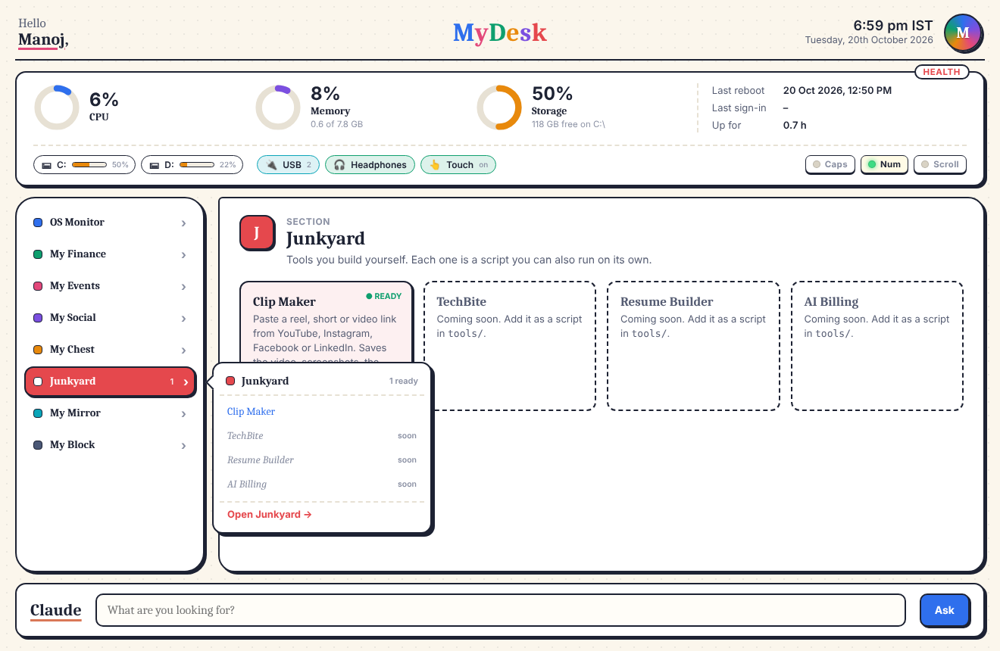
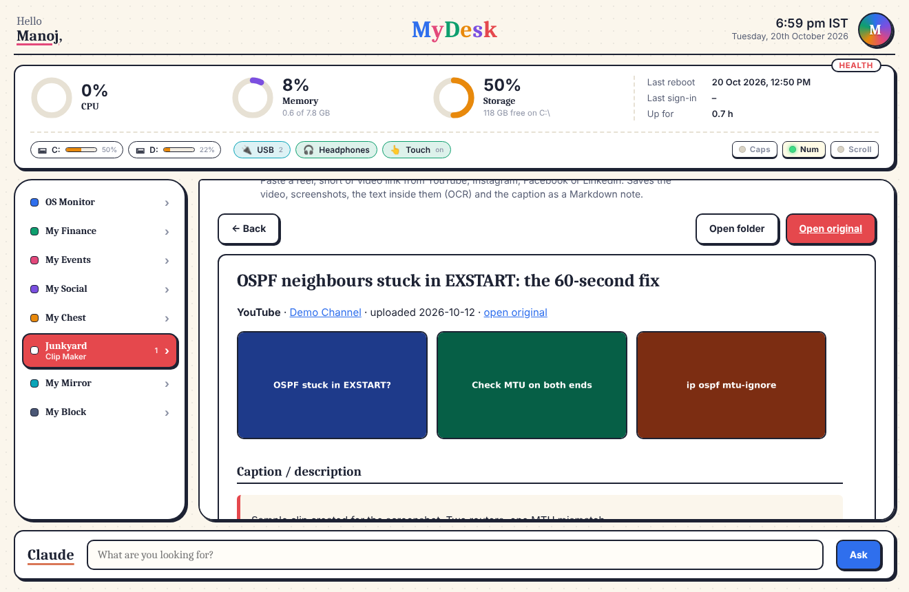
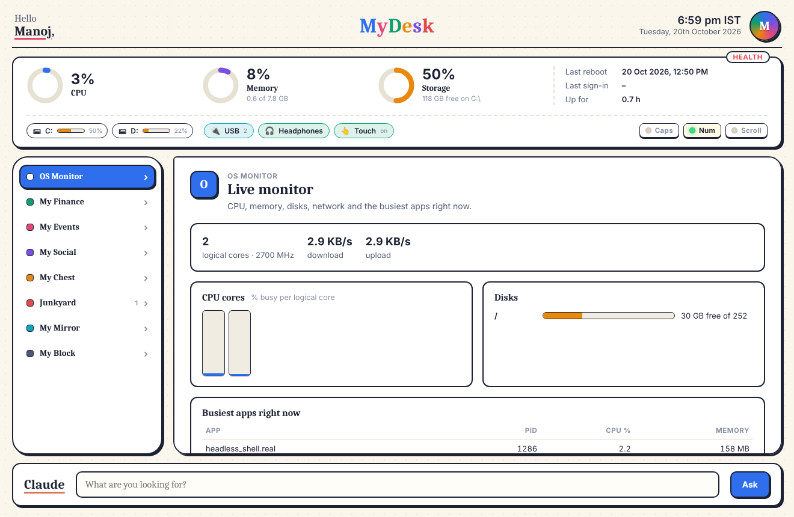

# MyDesk

**A colourful personal desktop app that holds all your own tools in one place.** It starts with your computer, shows live system health, and groups tools into sections like Finance, Events, Social and Junkyard. Every tool is a plain Python script, so you can run it from the app or from a terminal.



- **Starts with Windows** (or macOS/Linux login) as its own window
- **Live health strip:** CPU, memory, storage, last reboot and sign-in
- **Eight sections** with hover menus that stay tidy however many tools you add (a filter box appears when a section has more than 8)
- **Every tool is a script:** add a folder with a `tool.json` and the app builds its form for you
- **Search + Claude box:** type to jump to any section or tool, or ask Claude if you set an API key
- **Local only:** the app runs on `127.0.0.1` with a per-launch access token. Nothing leaves your machine unless a tool fetches something.

## Included tools

### Clip Maker (Junkyard)

Paste a reel, short or video link from YouTube, Instagram, Facebook, LinkedIn, X or any of the ~1800 sites [yt-dlp](https://github.com/yt-dlp/yt-dlp) supports. Clip Maker:

1. downloads the video with **yt-dlp**
2. takes screenshots at the start, middle and end with **ffmpeg** (bundled, nothing to install)
3. reads the text in those frames with **OCR** ([RapidOCR](https://github.com/RapidAI/RapidOCR), with Tesseract as a fallback)
4. saves the caption / description, author, upload date, tags and counts
5. writes a Markdown note (`clip.md`) and an HTML copy, shown in MyDesk with the video player

| Save a clip | Saved note |
| --- | --- |
|  |  |

Instagram and Facebook usually need you signed in. Pick your browser under **Use my login from**: Firefox works best, because Chrome and Edge lock their cookies while they're open.

> Saved videos are for your personal reference. They belong to their creators, and most platforms' terms don't allow re-uploading them.

### OS Monitor

Live per-core CPU, disks, network speed and the busiest apps, refreshed every 3 seconds.



## Sections

| Section | For | Status |
| --- | --- | --- |
| OS Monitor | System health | Live monitor |
| My Finance | Investments, accounts, budget | Planned |
| My Events | Calendars, birthdays, reminders | Planned |
| My Social | Follows, posting, blog drafts | Planned |
| My Chest | Bills, spending, subscriptions | Planned |
| Junkyard | Your own experiments | Clip Maker |
| My Mirror | Photos and videos | Planned |
| My Block | Certificates and important documents | Planned |

Rename sections, change colours or list planned tools in [`sections.json`](sections.json).

## Install

You need **Python 3.10–3.13** (Anaconda's Python works too).

**Windows:** download or clone this repo, then double-click **`install.bat`**. To install without starting at sign-in, run `install.bat -NoStartup`.

**macOS / Linux:**

```bash
git clone https://github.com/<you>/MyDesk.git
cd MyDesk && ./install.sh          # add --no-startup to skip login start
```

The installer creates a private environment in `.venv`, installs the packages, adds shortcuts, registers MyDesk to open when you log in, and starts it.

| | Windows | macOS / Linux |
| --- | --- | --- |
| Open MyDesk | Desktop / Start menu shortcut, or `MyDesk.bat` | `./mydesk.sh` |
| Run a tool | `run_tool clip_saver "<url>"` | `./run_tool.sh clip_saver "<url>"` |
| Stop starting at login | `remove_startup.bat` | delete `~/.config/autostart/mydesk.desktop` or `~/Library/LaunchAgents/com.mydesk.app.plist` |

### Settings

Copy `config.example.json` to `config.json` to set your name (otherwise your OS username is used), the time-zone label and the window size. `config.json` and everything in `data/` are git-ignored, so your settings and saved clips never get committed.

### Chat with Claude (optional)

Typing in the Claude box always searches your sections and tools. To ask Claude questions too, set an [Anthropic API key](https://console.anthropic.com/) and restart MyDesk:

```powershell
setx ANTHROPIC_API_KEY "sk-ant-..."      # Windows
```

```bash
export ANTHROPIC_API_KEY="sk-ant-..."    # macOS / Linux, e.g. in ~/.zshrc
```

## Run tools without the app

```bat
run_tool list
run_tool clip_saver "https://www.youtube.com/shorts/XXXX"
run_tool clip_saver "https://www.instagram.com/reel/XXXX/" --cookies-from-browser firefox
run_tool clip_saver "<url>" --no-video --shots 5
```

## Add your own tool

Copy `tools/_template` to `tools/<your_tool>`, edit `tool.json` (name, section, form inputs) and write the script. Restart MyDesk and the tool appears in its section's menu. The full guide is in [CONTRIBUTING.md](CONTRIBUTING.md).

## How it works

```
mydesk.py          starts the local server and opens the window (pywebview → Edge WebView2 / WebKit / Qt;
                   falls back to a Chrome/Edge app window)
mytool.py          command-line runner for any tool
core/              config, tool discovery, job runner, system health, HTTP server
ui/                the interface (plain HTML, CSS, JavaScript; no build step)
tools/<id>/        one folder per tool: tool.json + script
sections.json      the sections and their colours
data/<tool>/       everything tools save (git-ignored)
```

Run the checks with `python -m unittest discover tests`. GitHub Actions runs them on Windows, macOS and Linux for every push.

## License

[MIT](LICENSE)
